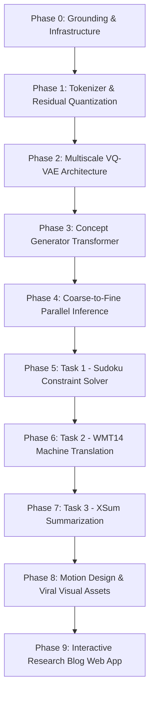

# NCM-Apex: Next-Concept Modeling Master Project Specification & Roadmap

## 1. Executive Summary & Foundational Motivation

Modern natural language processing is dominated by two divergent generative paradigms, each suffering from severe computational bottlenecks:

1. **Autoregressive (AR) Next-Token Models:**
   - **Generation Topology:** Generates tokens sequentially: $p(x_{1:L}) = \prod_{i=1}^L p(x_i \mid x_{<i})$.
   - **Hardware Bottleneck:** Memory-bandwidth bound. To generate $L$ tokens, the model requires $L$ distinct sequential memory roundtrips over the key-value (KV) cache and model parameter tensors. With large sequence lengths, arithmetic intensity drops precipitously ($O(1)$ FLOPs per byte loaded per token), causing expensive tensor cores to sit idle while waiting for high-bandwidth memory (HBM).
   - **Latency:** $\mathcal{O}(L)$ sequential forward passes. Speculative decoding and multi-token prediction mitigate latency by small constant factors ($1.5\times - 2.5\times$), but cannot bypass sequential token-by-token dependencies.

2. **Diffusion Language Models (DLMs) & Iterative Masked LMs:**
   - **Generation Topology:** Parallel refinement over the full token length $L$ through iterative denoising or mask unmasking across $T$ discrete timesteps: $p(x_0 \mid x_T) = \prod_{t=1}^T p(x_{t-1} \mid x_t)$.
   - **Hardware Bottleneck:** Compute-heavy. Generating a sequence of length $L$ requires $T \in [64, 128]$ full forward evaluations across the entire sequence length $L$. While every step is parallel across length $L$, the total FLOP expenditure is $T \times$ higher than single-pass generation. Moreover, DLMs struggle with discrete text structure, exhibiting high likelihood degradation and mode-collapsing on structured syntax.

3. **Next-Concept Modeling (NCM) — Breaking the Pareto Frontier:**
   - **Core Thesis (arXiv:2610.14162v1):** Text generation does not need to proceed strictly left-to-right at single-token granularity, nor does it require iterative diffusion over the entire sequence. Human thought organizes content hierarchically: global semantics and high-level structure (concepts) are conceived first, followed by successive syntactic refinement into exact lexical tokens.
   - **Two-Stage Generation Hierarchy:**
     - **Stage 1 (Representation):** A multiscale residual vector-quantized variational autoencoder (RVQ-VAE) tokenizes a token sequence $x_{1:L}$ into $K$ hierarchically downsampled discrete latent sequences $r_1, r_2, \dots, r_K$. The coarsest level $r_1$ has length $l_1 = \lfloor L / 2^{K-1} \rfloor$, capturing macroscopic semantic gist. Each subsequent level $k$ doubles spatial resolution ($l_k = 2 \cdot l_{k-1}$), predicting residual quantizations that culminate in exact lexical reconstruction at level $K$ ($l_K = L$).
     - **Stage 2 (Generation):** A standard Transformer prior generates the hierarchy **coarse-to-fine**. At each scale $k$, all $l_k$ discrete concept tokens are predicted **in parallel in a single forward pass**, conditioned on the accumulated representations of earlier scales $\hat{z}^{(k-1)}$.
   - **Complexity & Speedup:** Total sequential model evaluations equal the number of scales $K \in [3, 5]$, rather than sequence length $L \in [128, 2048]$ (AR) or diffusion steps $T \in [64, 128]$ (DLM). NCM delivers a **$9\times$ to $31\times$ speedup** over leading diffusion language models while matching or exceeding autoregressive task performance.

```
┌──────────────────────────────────────────────────────────────────────────────────┐
│                             GENERATIVE PARADIGMS                                 │
├──────────────────┬─────────────────────────────┬─────────────────────────────────┤
│ Model Family     │ Sequential Step Complexity  │ Arithmetic Intensity / Bottleneck│
├──────────────────┼─────────────────────────────┼─────────────────────────────────┤
│ Autoregressive   │ O(L) steps (1 token / step) │ Memory-bandwidth bound (KV read)│
│ Diffusion (DLM)  │ O(T) steps (64-128 passes)  │ Compute bound (T * L FLOPs)     │
│ NCM (Ours)       │ O(K) steps (K = 3 to 5)     │ Compute & Latency Optimal       │
└──────────────────┴─────────────────────────────┴─────────────────────────────────┘
```

---

## 2. The Big Architectural Question: "Are We Changing the LLM Architecture?"

A critical architectural distinction must be made regarding NCM:

> **Core Insight:** We are **NOT** replacing the core Transformer block. The internal architecture consists of standard Multi-Head Self-Attention (or Grouped-Query Attention), SwiGLU / GeLU feed-forward networks, RMSNorm, and Rotary Position Embeddings (RoPE).
>
> What changes fundamentally is the **Generation Topology and Conditioning Mask:**
> 1. **From Temporal Autoregression to Scale Autoregression:** Standard autoregressive models decompose distributions causally across sequence length ($p(x_i \mid x_{<i})$). NCM decomposes distributions across hierarchical abstraction scales ($p(r_k \mid r_{<k})$).
> 2. **Block-Diagonal Attention Masks:** Tokens at scale $k$ attend fully to tokens from coarse scales $1, \dots, k-1$, but tokens within scale $k$ use bidirectional (non-causal) attention over their peer scale tokens during training, or block-causal attention that prevents fine scales from leaking into coarse scales.
> 3. **Additive Continuous Conditioning with Conditioning Corruption:** Past scale tokens are unquantized, mapped to continuous residual embeddings $\hat{z}^{(k-1)}$, perturbed via a noise scheduler to prevent exposure bias, and injected as prefix/cross-conditioning tokens into the generator.

---

## 3. Comprehensive 10-Phase Project Lifecycle & Milestones

The NCM-Apex lifecycle is divided into 10 structured phases. Each phase requires an authoritative audit report (`phases_Tests/testing_report_phase_X.md`) validating rigorous exit criteria before transitioning to the next phase.



### Phase 0: Grounding, Repo Ingestion & Infrastructure (Current Phase)
- **Objective:** Workspace discovery, dependency environment isolation with GPU CUDA acceleration, directory scaffolding, foundational documentation creation.
- **Deliverables:** `docs/PROJECT_SPEC.md`, `docs/ARCHITECTURE_NCM.md`, `docs/HARDWARE_BUDGET_3070TI.md`, `docs/BLOG_STYLE_GUIDE.md`, `docs/LINKEDIN_ASSETS_GUIDE.md`, `requirements.txt`, `phases_Tests/testing_report_phase_0.md`.
- **Exit Criteria:** Isolated environment verified with CUDA capability, official codebase ingested, documentation complete and approved.

### Phase 1: Mathematical Foundations & Multiscale RVQ Tokenizer
- **Objective:** Implement the discrete hierarchical representation engine.
- **Key Modules:** Multiscale Residual Vector Quantizer (`src/layers/quant.py`), Codebook vector lookup, Straight-Through Estimator (STE), Commitment Loss ($\beta = 0.25$), Codebook EMA updating, and Nested Scale Dropout ($p_{\text{drop}} \in [0.1, 0.3]$).
- **Exit Criteria:** Unit tests verifying codebook utilization $> 85\%$, zero dimension mismatches across $K \in \{3, 4, 5\}$ scales, reconstruction loss convergence on toy sequence data.

### Phase 2: Multiscale VQ-VAE Architecture & Text Reconstruction
- **Objective:** Build the complete Stage-1 Tokenizer (`src/models/vqvae.py`, `src/models/vae.py`).
- **Key Modules:** 1D Temporal ResNet / Dilated Conv encoder downsamplers ($\text{Down}_k$), continuous latent bottleneck, hierarchical quantizers, and transposed conv / MLP upsampler decoder ($R_k$).
- **Exit Criteria:** Reconstruction cross-entropy on sample corpus $\mathcal{L}_{\text{tok}} \le 0.45$, byte/token roundtrip validation, verified hierarchical codebook hierarchy.

### Phase 3: Next-Concept Transformer Generator & Corruption Scheduler
- **Objective:** Build the Stage-2 Prior Generator (`src/models/next_concept.py`, `src/layers/attention.py`).
- **Key Modules:** Transformer decoder with block-diagonal self-attention, scale-level positional embeddings, continuous conditioning projector for $\hat{z}^{(k-1)}$, and conditioning corruption scheduler (codebook uniform noise injection).
- **Exit Criteria:** Teacher-forcing loss downward trajectory, block-diagonal attention mask unit test verifying strict unidirectional information flow from coarse to fine scales, memory footprint $< 4.5$ GB VRAM.

### Phase 4: Coarse-to-Fine Parallel Inference & Minimum Bayes Risk (MBR) Decoding
- **Objective:** Implement the fast parallel generation pipeline (`src/engine/generator.py`, `src/engine/mbr.py`).
- **Key Modules:** $K$-step coarse-to-fine generation loop, temperature/top-$p$ sampling per scale, MBR candidate generation ($N \in [8, 32]$ parallel samples at scale $K$), utility scoring (ROUGE / BLEU / string consensus), consensus centroid selection.
- **Exit Criteria:** Benchmark latency showing $K$ forward passes for length $L=512$, generation speedup $\ge 10\times$ vs. step-by-step decoding, MBR selection pipeline automated.

### Phase 5: Empirical Benchmark 1 — Sudoku Constraint Satisfaction
- **Objective:** Evaluate NCM's parallel non-autoregressive spatial reasoning on 9x9 Sudoku boards.
- **Key Modules:** Sudoku tokenizer (`src/utils/sudoku.py`), constraint validity evaluator, benchmark harness comparing AR, Masked Diffusion, and NCM on Easy/Medium/Hard splits.
- **Exit Criteria:** Solved board rate, cell accuracy $> 98\%$, valid grid rate, generation within 4 scale passes ($K=4$).

### Phase 6: Empirical Benchmark 2 — WMT14 De-En Machine Translation
- **Objective:** Evaluate conditioned generation quality and parallel speed on bilingual translation.
- **Key Modules:** Cross-attention / prefix conditioning with source German sentences, sacreBLEU and chrF scoring pipeline, classifier-free guidance ($\text{cfg}=1.0$).
- **Exit Criteria:** SacreBLEU score parity with official reported results, latency tracking on RTX 3070 Ti.

### Phase 7: Empirical Benchmark 3 — XSum Extreme Summarization
- **Objective:** Evaluate long-context conditioning and coarse semantic abstraction to fine summary synthesis.
- **Key Modules:** Document encoder, ROUGE-1/2/L evaluation harness, generative perplexity validation with GPT-2 Large.
- **Exit Criteria:** ROUGE scores within 0.5 points of published paper benchmarks, full evaluation telemetry logged.

### Phase 8: Publication-Grade Motion Design & Viral Visual Assets
- **Objective:** Produce high-engagement visual assets for technical audiences and LinkedIn showcase.
- **Key Modules:** Manim scripts (`src/visualizers/manim_render.py`), OpenCV/MoviePy composite generator (`src/visualizers/video_builder.py`).
- **Deliverables:**
  - Split-screen comparison video: AR token-by-token vs. Diffusion noise reduction vs. NCM coarse-to-fine concept flash.
  - Sudoku step-by-step resolution animation ($4$ steps vs $81$ steps).
  - Translation trajectory heatmap showing BLEU progression per scale.
- **Exit Criteria:** 60fps high-bitrate MP4/WebM renders in both 16:9 and 1:1/9:16 aspect ratios.

### Phase 9: Interactive Research Blog Web App Integration
- **Objective:** Build and integrate the authoritative research article into the user's established Astro blog (`MYBLOG`).
- **Key Modules:** MDX / Markdown article in `MYBLOG/src/content/blog/ncm-apex/index.md`, incorporating Temml MathML equations, Expressive Code interactive snippets, embedded motion design video loops, and interactive architecture visualization.
- **Exit Criteria:** `astro build` passes with zero errors, styling conforms 100% to the Vagabond Dark Ink & Parchment aesthetic, typography and callouts render perfectly.

### Phase 10: Production Artifact Packaging, Release & Final Audit
- **Objective:** Complete codebase freeze, end-to-end automated testing suite, artifact bundle generation, and final senior engineering presentation.
- **Deliverables:** Full Git repository with reproducible checkpoints, comprehensive README, interactive CLI demo, final testing report `testing_report_phase_final.md`.
